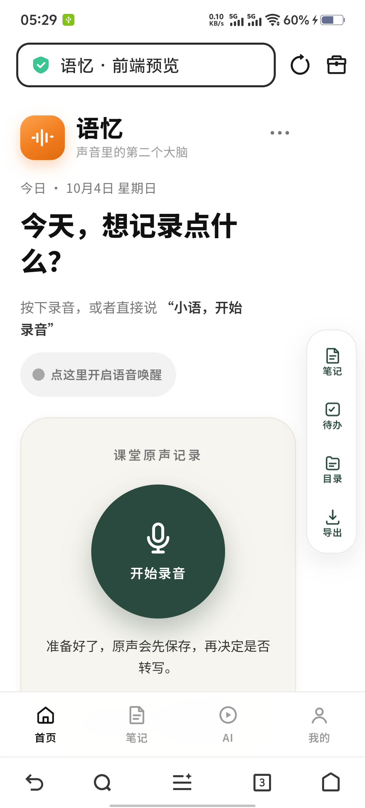
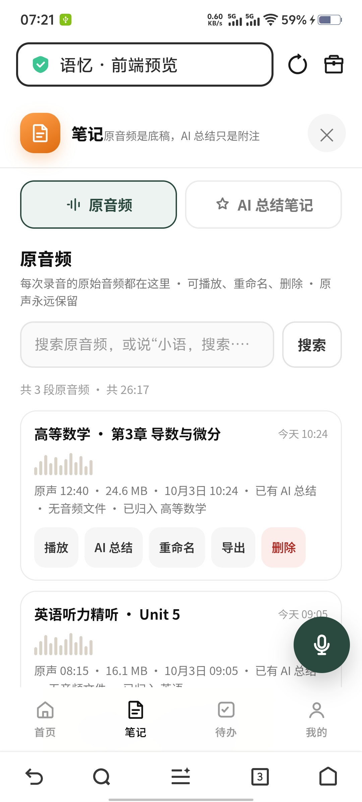
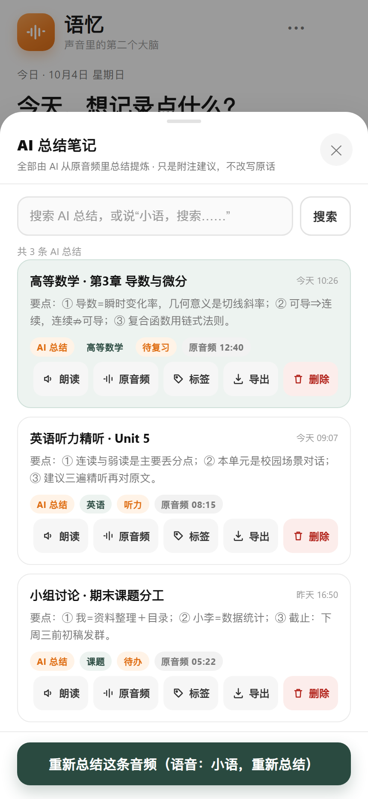
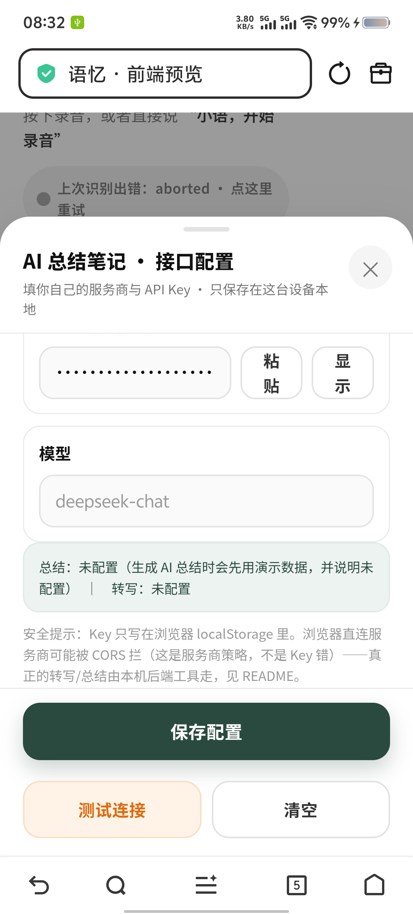
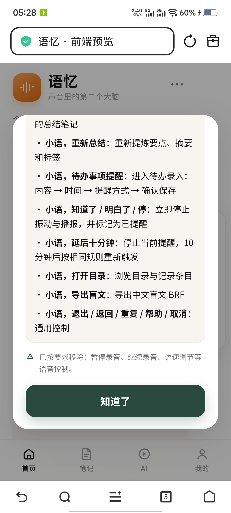
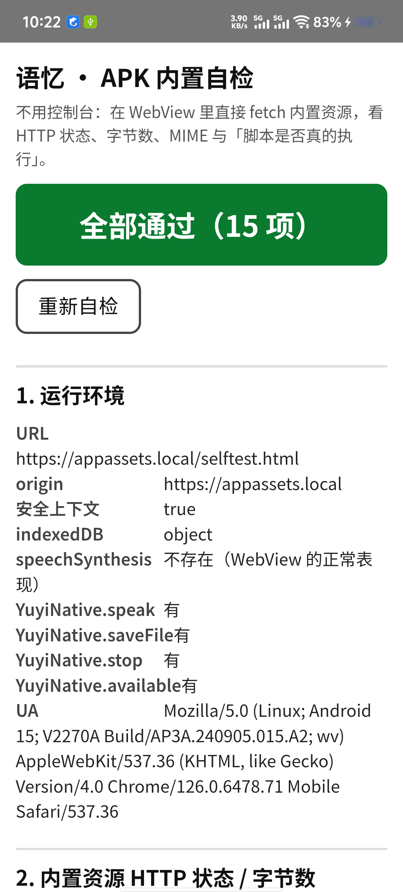
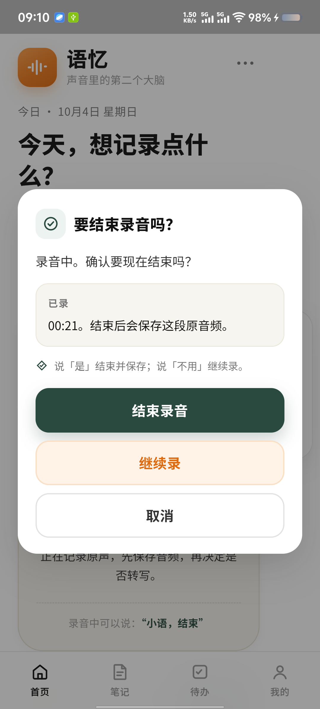

# 语忆（Yuyi）

> **给视障学生的语音笔记工具：按下录音、说「小语，结束」，笔记就存好了 —— 全程可以只用耳朵和手指，不用看屏幕。**

`🎯 为视障学生做的` · `📴 手机端离线识别` · `⠿ 真·盲文导出（Word / BRF）` · `🗣 全程可仅用语音` · `📄 单文件零依赖前端` · `🤖 安卓 APK`

语忆是一个**单页应用**（`index.html`，390,028 字节，零外部依赖）+ 一个**极薄的安卓外壳**。
它把「上课录音 → 变成能复听的笔记 → 导出成能摸的盲文」这条链路，压缩成**一句话就能走完**的流程。

---

## 目录

- [1. 产品介绍](#1-产品介绍)
- [2. UI 截图](#2-ui-截图)
- [3. 快速开始](#3-快速开始)
- [4. 使用说明](#4-使用说明)
- [5. 无障碍设计说明](#5-无障碍设计说明)
- [6. 已知边界（诚实清单）](#6-已知边界诚实清单)
- [7. 技术栈与架构](#7-技术栈与架构)
- [8. 许可证](#8-许可证)
- [9. 仓库结构](#9-仓库结构)

---

## 1. 产品介绍

### 解决什么问题

一个视障学生上课时，面前通常是这三样：一个录音笔、一个笔记本、和一份「课后要整理的转录稿」。
现实里的痛点是：

| 痛点 | 现实长什么样 |
|---|---|
| **录了但用不上** | 录音笔里躺着 40 分钟音频，要「找到第 3 章导数那段」只能从头快进着听 |
| **整理必须靠眼睛** | 主流笔记 App 的「AI 总结」要你看着屏幕改错字、拖动排序、点保存 |
| **笔记不可触摸** | 中文盲文排版工具几乎都在 PC 上，手机端基本没有；要「摸」的笔记得另外找人转 |
| **一步一确认** | 很多 App 的语音只是「输入法」，流程本身还是要手指点：点录音、点停止、点保存、点导出 |

### 给谁用

- **主要用户**：使用读屏（TalkBack 等）的视障学生、低视力学生。
- **次要用户**：任何「手不方便看屏幕」的场景 —— 走路、骑车后、手上全是东西时记一件事。
- 设计上的硬约束只有一条：**语音和振动不可用的时候，这个产品就废了**。
  所以所有功能都必须有「**纯听觉 + 触觉**」的走法，屏幕只是附赠。

### 核心流程（一张文字图）

```
                    ┌─────────────────────────────────────────┐
   按下录音 /       │  ① 归类：这段原音频归到哪个类目？        │
   说「小语，开始录音」│     （说一个名字 → 小语复述 → 说「对」） │
        │           └─────────────────────────────────────────┘
        ▼                            ▲
  ┌───────────┐   说「小语，结束」    │  ② 要不要做 AI 笔记总结？
  │  录音中…   │──────────────┐      │     （要 → 离线转写 + 大模型提炼要点/标签）
  │ 可暂停/继续│              │      │
  └───────────┘         ┌────▼──────┴───────────────────────────┐
                        │  ③ 这条 AI 笔记归到哪个类目？          │
                        └──────────────────┬───────────────────┘
                                           ▼
                        ┌──────────────────────────────────────┐
                        │  ④ 要不要导出？                        │
                        │  ① 中文盲文 Word（默认）               │
                        │  ② 盲文 BRF（点显器 / 盲文打印机）      │
                        │  ③ 中文 Word（普通文字）               │
                        └──────────────────┬───────────────────┘
                                           ▼
                          文件真的落到手机「下载」目录
```

**关键设计**：每一步都有**语音提问 + 语音回答**，也都有**按钮**。
你可以全程不动屏幕；也可以全程不说话，只点按钮。两条路走的是同一套状态机。

---

## 2. UI 截图

> 全部取自真机（vivo V2270A / iQOO Z7，1080×2388）。**已逐张确认：没有任何明文 API Key。**
> AI 配置页里 Key 输入框显示的是掩码圆点（`••••••`）。

### 首页 · 待机



中间是**开始录音**大按钮，右侧竖排四个入口（笔记 / 待办 / 目录 / 导出），底部四个 Tab（首页 / 笔记 / AI / 我的）。
「点这里开启语音唤醒」是**语音开关**，它的文案会随真实状态变化：未开启是灰的、识别中是绿的并显示听到了什么、浏览器不支持会明说。

### 笔记页 · 顶部两个按钮



顶部两个按钮就是两类内容的分界：**原音频**（永远保留的底稿）和 **AI 总结笔记**（附注，不改原话）。
列表里每条都能播报出「原声 12:40 · 24.6 MB · 已有 AI 总结 · 已归入 高等数学」。

### 笔记正文 · AI 总结



每条总结包含：**要点**（①②③ 编号，方便用「下一条」逐条听）、**标签**、以及
朗读 / 原音频 / 标签 / 导出 / 删除。底部是「重新总结这条音频」（语音：小语，重新总结）。

### AI 接口配置 · Key 是掩码的



「选服务商 → 点粘贴 → 保存」。Key 只写进浏览器 `localStorage`，**不上传任何服务器**。
注意状态行会如实说「总结：未配置（生成 AI 总结时会先用演示数据，并说明未配置）」——
**没配就说没配，不假装成功**。

### 语音指令表 · 帮助页



这就是「有哪些话能说」的权威列表，随版本更新。底部的 ⚠️ 是刻意的诚实标注：
**暂停录音 / 继续录音 / 语速调节** 已被移除，不在语音控制范围内（按钮上有）。

### APK 内置自检 · 15 项全部通过



这是安卓壳**自带的诊断页**（不是产品页面），用来在真机上一眼看出：
内置资源通不通、WebView 环境是什么样、**TTS 桥在不在**。
这张图同时解释了一个重要事实：WebView 里 `speechSynthesis` **不存在**，
所以 App 必须自带原生 `TextToSpeech` 桥（`YuyiNative.speak`）。

### APK · 「要结束录音吗？」二次确认



这是**课堂防误停**（P0-G #6）的落地样子：录音中必须说完整唤醒词「**小语，结束**」，
然后小语会**出声反问你一次**，你说「是」才真的结束。理由很实在：
课堂上同学咳嗽、老师说「结束」、隔壁有人聊天，都可能让误触发把一整节课毁掉。
（这是 APK 截图 —— 没有浏览器地址栏。）

---

## 3. 快速开始

### 方式一：直接在浏览器里预览（30 秒）

```powershell
# 在仓库根目录
双击  手机预览.bat
# 等价于：
python _tools/serve-mobile.py
```

脚本会打印两个地址，**这两个端口的差别很重要**：

| 地址 | 协议 | 什么时候用 | 为什么 |
|---|---|---|---|
| `http://127.0.0.1:8790/` | HTTP | **电脑上**看，或手机 USB 直连 | **`http://127.0.0.1` 也被浏览器视为「安全上下文」**，所以麦克风、振动、通知、Service Worker 都能用，而且**没有自签证书的「不安全」提示** |
| `https://<电脑局域网IP>:8444/` | HTTPS | **手机连同一个 WiFi** 时用 | 手机访问电脑不是 `127.0.0.1`（不是安全上下文），必须走 HTTPS。证书由脚本用 `cryptography` **现场自签**，SAN 里带上当前局域网 IP |

> HTTPS 首次打开会提示「连接不安全」→ 点「高级」→「继续前往」。
> **证书是脚本自动生成的**（落在 `_tools/.cert/`，该目录不进仓库），所以不需要任何手工配置；
> 只要装了 `pip install cryptography`。

手机 USB 直连（不想连 WiFi 时）：

```powershell
双击  手机USB直连.bat     # 插上手机自动 adb reverse + 打开页面，拔插自动重建
```

它只映射本项目的两个端口（8790 / 8444），**不会**动你其它项目的端口映射。

> **`file://` 直接双击 `index.html` 也能看界面**，但 Service Worker 注册会被拒（origin 为 `null`），
> 于是系统通知弹不出来、振动也可能被限制。要真机体验请务必走上面的服务。

### 方式二：装 APK（离线识别 + 原生 TTS + 文件落到「下载」）

APK 才能拿到完整体验：**离线识别**、**原生 TTS 播报**（WebView 没有 `speechSynthesis`）、
**导出文件真的写到手机「下载」目录**。

完整构建步骤见 **[docs/BUILD.md](docs/BUILD.md)**（无 Gradle、无 Android Studio，9 步手工链，可完全复现）。
最短路径：

```powershell
# 1) 先把离线识别引擎和模型拉下来（约 47 MB，一次就够）
python _tools/fetch-asr-wasm.py

# 2) 把 JDK17 / build-tools r34 / platform-34 解压到 android\.toolchain\
#    下载地址见 docs/BUILD.md

# 3) 构建
powershell -ExecutionPolicy Bypass -File android\build-apk.ps1
# → android\dist\yuyi-offline-v1.0.0.apk
```

---

## 4. 使用说明

### 4.1 录音：开始 / 暂停 / 继续

| 想做什么 | 用嘴 | 用手 |
|---|---|---|
| 开始录音 | 说「**小语，开始录音**」 | 点中间的大圆（开始录音） |
| 暂停 | ❌ 语音不支持（刻意移除） | 点录音卡片上的「暂停」 |
| 继续 | ❌ 语音不支持（刻意移除） | 点「继续」 |
| 结束并保存 | 说「**小语，结束**」 | 点「结束录音」 |

> **为什么暂停/继续不做语音？** 因为「暂停」和「结束」在嘈杂的教室里极易互相误判。
> 少两个语音指令，换来「一节课不会被半句话毁掉」。

**录音的逻辑是「原声优先」**：按下录音就开始存原始音频，**先保存音频，再决定要不要转写**。
所以哪怕后面 AI 总结失败，你的原声永远在「笔记 → 原音频」里。

### 4.2 结束录音：「小语，结束」三步确认（课堂防误停）

这是**最容易被误触发**的一步，所以走了三步（P0-G #6）：

```
① 必须带完整唤醒词          ② 小语出声反问一次            ③ 你说「是」才真结束
   「小语，结束」              「要结束录音吗？已录 00:21。      → 保存原音频
   ❌ 只说「结束」不认          说『是』结束并保存，            
                              说『不用』继续录。」            
```

- 只说「结束」**不会**停止录音（唤醒词是硬门槛）。
- 反问弹窗里有三个按钮：**结束录音 / 继续录 / 取消**，都能点。
- 说「不用」= 继续录，录音不会中断。
- 已录时长会念出来（「已录 00:21」），让你确认没白录。

见上方截图 [APK · 「要结束录音吗？」二次确认](#apk--要结束录音吗二次确认)。

### 4.3 录音结束后的四步引导

说完「小语，结束」并确认后，小语会**依次问你四件事**，每一步都能只听不点：

| 步 | 小语问什么 | 你怎么答 |
|---|---|---|
| **① 归类** | 「这段原音频归到哪个类目？」 | 说出类目名（见 4.4），或说「跳过」 |
| **② 是否 AI 总结** | 「要不要做 AI 笔记总结？」 | 说「要」/「不用」 |
| **③ 笔记归类** | 「这条 AI 笔记归到哪个类目？」 | 说类目名，或说「同上」 |
| **④ 是否导出** | 「要不要导出？」 | 说「要」= 默认中文盲文 Word；也可说「中文文档」「盲文」 |

**任何时候说「重复」，小语会把当前这一问原样重念一遍** —— 这是盲人最基本的需求。
每问一步，屏幕外的 `#srStatus` / `#srAlert` 也会同步播报，两条通道不互相顶掉。

### 4.4 类目自己起名（说名字 → 复述确认 → 说「对」）

**类目不是从固定列表里选，而是你自己起名**：

```
你说：  「高等数学」
小语：  「新建类目：高等数学。对吗？」
你说：  「对」
→ 类目建好，这条音频归进去了
```

- 说错随时说「**重说**」/「**再说一遍**」，小语会重新问。
- 类目名会**原样保留你的自由文本**（只剥掉唤醒词和「归到…」这类引导词），
  所以「第3章 导数与微分」这种长名字也认。
- 这个类目之后会在「目录」面板里出现，可用「小语，打开目录」浏览。

### 4.5 待办与提醒：语音 5 步

说「**小语，待办事项提醒**」，进入 5 步语音录入（每一步都有 `#srStatus` 播报）：

| 步 | 小语说什么 | 你做什么 |
|---|---|---|
| **1** | 「请口述录入待办事项内容，说完后说**完成录入**。」 | 说内容 → 说「完成录入」 |
| **2** | 「已识别待办事项，请问**内容是否正确**？」 | 说「对」/「不对」重来 |
| **3** | 「请问**设置提醒时间**？」 | 说「明天早上八点」「10 分钟后」等 |
| **4** | 「**提醒方式**选择闹钟响铃，还是震动？」 | 说「震动」或「铃声」 |
| **5** | 「请**确认保存**。」 | 说「是」→ 保存 |

**到点提醒走三条通道**（不是一条）：

1. **触觉振动**（三段式节奏，静音也有效）
2. **系统通知**（与振动同时刻）
3. **语音播报**（第一组振动结束后启动，慢速**重复 2 遍**）

你可以说「**小语，知道了 / 明白了 / 停**」立刻停掉，或说「**小语，延后十分钟**」。
两个动作也都有按钮（`知道了，停止振动并标记这条待办为已提醒` / `延后十分钟…`），
语音指令**优先于触摸、不等播报读完**。

> 想验证手机马达好不好使：待办面板里有「**试一次三段式振动节奏**」按钮，
> 语音说「**试听**」也行 —— 它会**同时震动两下并出声**，于是你能判断出：
> **有振动没声音 = 媒体音量问题**；**有声音没振动 = 马达或权限问题**。这个设计是为了让失败可诊断。

### 4.6 四句「不会迷路」的标准指令

这四句是刻意挑出来的，因为**盲人无法截屏、无法一眼看全屏**：

| 说 | 作用 | 为什么必须有 |
|---|---|---|
| 「**我在哪**」 | 报出当前页面 / 面板 / 是不是在录音 | 防迷路。读屏用户最容易「不知道自己现在在哪一层」 |
| 「**下一条**」 | 列表里往下走一条，并念出内容 | 浏览列表的**唯一可行途径**（靠听） |
| 「**上一条**」 | 列表里往上走一条 | 同上，回退 |
| 「**重试**」 | 重来一次刚才失败的识别 / 操作 | 短唤醒词模型会听错，必须给「再来一次」的出口 |
| 「**报告问题**」 | 把当前状态、页面、最近错误**全部念出来** | ⭐ **盲人无法截屏 —— 这是远程求助的唯一通道**，所以能念的全念 |

「报告问题」的取舍写得很直白：宁可啰嗦，也要让电话那头的家人/老师听明白你在哪一屏、卡在哪一步。

### 4.7 「重复」和「试听」

- 「**重复**」：重念**当前这条提问**（不是上一条提示）。没有当前提问时，才退回上一条提示。
  实现上是把每句提问存进 `lastAsk`，所以翻页时上下文会立刻解除保护，不会念串。
- 「**试听**」：见 4.5 —— 它是**振动 + 声音的联合自检**，不是「播放录音」。
  播放录音请用「原音频」面板里每条的「播放」。

### 4.8 导出：三种格式，文件落到手机「下载」

小语问「要不要导出」时，说「要」= 默认格式（**盲文优先**），也可以直接点名：

| 格式 | 说什么 | 扩展名 | 给谁用 |
|---|---|---|---|
| **中文盲文 Word**（默认） | 「中文盲文 Word」/「要」 | `.docx` | 点字排版的中文盲文，可打印 |
| **盲文 BRF** | 「盲文」/「BRF」 | `.brf` | 盲文点显器 / 盲文打印机（标准盲文文件） |
| **中文 Word** | 「中文文档」/「中文 Word」 | `.docx` | 普通文字版，给看得见的人看 |

- **导出的内容是「这条 AI 总结笔记」**（不是原始录音），弹窗里有 `restate` 长念版说明三种格式。
- **在 APK 里**：文件真的写到手机**「下载」/ Download** 目录（API 29+ 走 MediaStore，不需要存储权限；
  API ≤28 才要 `WRITE_EXTERNAL_STORAGE`）。导出记录在「导出记录」面板里可重新下载。
- **在浏览器里**：走浏览器下载（落到浏览器的「下载」）。浏览器里没有原生保存桥，
  所以「导出没反应」多数是没等下载提示 —— 排查见 [docs/USAGE.md](docs/USAGE.md#4-排错表)。

### 4.9 AI Key 怎么填

「我的 → AI 接口配置」，两步：

```
① 选服务商（18 个预设：DeepSeek / 硅基流动 / 阿里云百炼 / Kimi / 智谱 / 火山方舟 / 混元 /
              千帆 / MiniMax / 讯飞星火 / Ollama / LM Studio / OpenAI / OpenRouter /
              Groq / Together / vLLM 自建 / 自定义）
   → 接口地址和常用模型会自动填好，不用管
② 点「粘贴」把 Key 贴进来 → 自动保存
```

要点：

- **总结**和**转写**是**两套独立配置**，可以用不同服务商（例：转写用硅基流动、总结用 DeepSeek）。
- 带「**有转写**」标记的服务商才有语音转写接口。
- **Key 只写在本机 `localStorage`**，不上传任何服务器。
- 「**测试连接**」会真发一次请求并报 HTTP 状态；被 CORS 拦会明说是服务商策略、**不是 Key 错**。
- **转写在本机离线完成，不会上传**；只有生成总结时才联网。

---

## 5. 无障碍设计说明

这一节写的是**已经落到代码里、可核对**的东西（不是愿望清单）。括号里是核对位置。

| 设计 | 具体做法 | 位置 |
|---|---|---|
| **读屏状态必须等于真实状态** | 语音药丸按真实状态显示：未开启 = 灰「点这里开启语音唤醒」／识别中 = 绿「小语正在待机监听 · 听到『…』」／浏览器不支持 = 橙「本浏览器不支持语音唤醒」。**不假装一直在监听**；识别服务连不上会明说并给出重试 | `index.html` 语音药丸 §10b |
| **双通道播报** | `#srStatus`（`role="status"` + `aria-live="polite"`）与 `#srAlert`（`role="alert"` + `aria-live="assertive"`）。两条**不互相顶掉**：曾经「不支持振动 + 通知被拒」两条互相覆盖，合并成一句 assertive 播报后修复 | `index.html:1506-1507` |
| **状态变更真的出声** | 关键反问不只写 aria-live，还**真的调 TTS**（`yuyiVoice`）。因为「只写 aria-live」对没开 TalkBack 的盲人用户是**一片安静** | `index.html:3335, 5700` |
| **44 px 可点区域** | 主按钮 44–50 px；右侧工具栏按钮 `width:44px;height:44px`；语音药丸 `min-height:44px`（原来是 35 px，真机上不好点，已改）。提醒弹窗按钮实测 `offsetHeight = 52 px` | `index.html:117, 129, 144` |
| **`prefers-reduced-motion`** | 关掉录音脉冲、药丸波形等动画（5 处媒体查询） | `index.html:67, 151, 193` |
| **空态会播报** | 每个列表都有空态文案并播报，例如笔记空态：「还没有 AI 总结笔记。录一段说『小语，结束』，小语会问你要不要做总结。」待办空态：「说『小语，待办事项提醒』新建一条。」**空屏不等于静音** | `index.html:2268-2269` |
| **失败要可听见** | 识别失败说「上次识别出错 · 点这里重试」；下载失败说「这段没有真实文件可下载。录音时没拿到麦克风，只存了记录；新录的音频能下载」；云端导出/转写失败**如实说明，绝不假装成功** | `index.html:2645, 3071` |
| **弹窗可达** | `role="dialog"` / `role="alertdialog"` + `aria-modal`，打开时焦点移入、Tab 焦点圈定、关闭后焦点**归还触发元素**（延后 250 ms 观测） | `README-预览说明.md §4` |
| **键盘/读屏可退** | `Esc` = 返回上一步（等同「小语，返回」）；只在键盘操作时显示焦点环，避免触屏视觉噪音 | `README-预览说明.md §4` |
| **不猜** | 喊了「小语」但没命中指令时，**明确说不知道并列出可用指令**，不瞎猜执行 | `README-预览说明.md §1` |

---

## 6. 已知边界（诚实清单）

写这一节的原则：**宁可显得弱，也不写没验过的话。**

### 6.1 云端识别在这台机型上不可用，所以改成了离线

真机实测（vivo V2270A / iQOO Z7）：浏览器 `webkitSpeechRecognition` **两次都固定返回 `aborted`**，
麦克风本身是好的（`getUserMedia` 取流成功，拾音峰值 0.242，安静时 0.002）。
**这就是「说了没反应」的根因** —— 不是权限问题，是该机型的云端语音通道不通。

于是产品走向了 **Vosk WASM 离线识别**：不联网、不上传、不依赖厂商通道。
代价是下面这些，我们照实写。

### 6.2 短唤醒词模型精度有限，离线转写可能慢于实时

- 用的是 **`vosk-model-small-cn-0.22`**（小模型，面向短指令）。长课堂录音的**精度一般，会有错字**，
  所以结果页必须如实标注「离线转写，可能有错字」，并给「重新总结 / 人工修正」的路径。
- 转写速度 **RTF ≈ 1.4–2.0**（Real Time Factor，> 1 表示**慢于实时**）：
  一段 10 分钟的课，可能要等 14–20 分钟才出文字。**这是小模型 + 手机 CPU 的现实**。
- 首次使用要下/解 **41.9 MB** 的模型（`model.tar.gz`，解包后约 65 MB），
  之后 `vosk-browser` 会把解包结果存进 **IndexedDB**，第二次打开会跳过。**首次会明显卡一会儿。**

### 6.3 部分机型需要安装 TTS 引擎

这是安卓壳的硬约束，值得单独说：

- **WebView 里没有 `speechSynthesis`**（真机自检页实测显示「不存在（WebView 的正常表现）」）。
  所以 App 必须自己接 **原生 `TextToSpeech`**，通过 `addJavascriptInterface` 暴露给页面（`YuyiNative.speak`）。
- 并且 manifest **必须**声明包可见性，否则 `TextToSpeech` 根本看不到系统引擎（`onInit` 直接 ERROR）：

  ```xml
  <queries><intent><action android:name="android.intent.action.TTS_SERVICE" /></intent></queries>
  ```

- **因此：手机上没有中文 TTS 引擎的机型，小语会是哑的。** 需要用户自行安装
  （Google TTS / 厂商语音服务等）。真机实测：`com.vivo.aiservice` 引擎初始化成功，
  `speak` 到 `onDone` 回调走完。
- 判断方法：打开 APK 内置自检（见 [docs/BUILD.md](docs/BUILD.md#8-怎么打开内置自检页)），
  看 `YuyiNative.available` / `speak` 是否为「有」。

### 6.4 Word / 盲文没有做真实渲染校验

- `docx` 生成器是**零依赖手写**的（ZIP + CRC32 + OPC），**137/137** 项结构校验通过、
  并用 `python-docx` 逐条回读验证。**但本机没有 LibreOffice，WPS 也没有可用的无头命令行**，
  所以「在 Word/WPS 里打开后视觉上长什么样」**没有验证过**。
- 盲文同理：**217/217** 项逐字符等价校验通过（含全表 44,388 条聚合校验和与 Python 一致），
  但**盲文点显器 / 盲文打印机实际打出来的效果没有验证过**。
- 也就是说：**文件格式是对的、内容是对的，排版观感未经人眼/人耳之外的手段确认。**

### 6.5 其它未验证

- **扬声器是否真的出声**：TTS 回调链走通了（`speak → onDone`），但「人耳听到」需人工确认。
- **iOS 全部未测**；**微信内置浏览器未测**。
- **低端机上的 WASM 离线识别性能未测**（内存、发热、首次加载时长）。
- **部分真机路径未覆盖**：例如「录音时 MediaRecorder 与识别引擎抢麦克风能否共存」——一直用喂文本的等价方式验证。
- **「整条纯语音链路端到端走通」没有实测**（各环节都验过，但没让一个盲人用户从开机走到导出）。
- 完整的验收与未验证清单见 **[docs/VERIFICATION.md](docs/VERIFICATION.md)**。

### 6.6 许可上的一个真实约束

`data/braille-zh.json`（中文盲文表）派生自 **Liblouis `zh-chn.ctb`，LGPL-2.1-or-later**，
**不受本仓库 MIT 覆盖**。再分发时请遵守 LGPL，详见 [THIRD-PARTY.md](THIRD-PARTY.md)。

---

## 7. 技术栈与架构

### 一句话

**一个单文件、零依赖的 HTML 应用 + 一个极薄的安卓 WebView 外壳。**
没有构建工具、没有 npm 依赖、没有框架、没有后端。

### 分层

```
┌──────────────────────────────────────────────────────────────────────┐
│  index.html （390,028 B，单文件，零依赖）                              │
│  ├─ UI 层：语义化 HTML + <button>，内联 SVG 图标，无字体/图标文件       │
│  ├─ 状态层：state.notes / state.audios / state.todos + DIRS           │
│  ├─ 语音层：MatchCmd 容错指令匹配（唤醒词可省略 / 口语填充 / 谐音）      │
│  ├─ 播报层：say()/alertSay()（aria-live）+ ttsSpeak()（真 TTS）        │
│  └─ 持久层：localStorage（配置/标记）+ IndexedDB（录音、Vosk 模型缓存）  │
└──────────────────────────────────────────────────────────────────────┘
        │                    │                        │
        │ 运行时加载          │ 运行时加载              │ 通过 JS 桥
        ▼                    ▼                        ▼
┌───────────────┐  ┌──────────────────┐  ┌──────────────────────────────┐
│ _tools/       │  │ data/asr/        │  │ android/                     │
│ docx-mini.js  │  │ yuyi-asr.js      │  │ MainActivity.java（WebView）  │
│  零依赖 docx   │  │  → window.YuyiASR│  │  └ YuyiNative.speak()        │
│  生成器        │  │ vosk.js (WASM)   │  │     .saveFile() .stop()      │
│ braille-zh.js │  │ model.tar.gz     │  │     .available()             │
│  中文盲文引擎   │  │  (离线模型)       │  │ 原生 TextToSpeech + MediaStore │
└───────────────┘  └──────────────────┘  └──────────────────────────────┘
```

### 几个值得说的技术选择

| 选择 | 为什么 |
|---|---|
| **单文件零依赖前端** | 视障用户的环境不可控（老手机、微信浏览器、离线）。少一个依赖就少一种「打不开」 |
| **Vosk WASM 离线识别** | 云端识别在目标机型上不通（见 6.1）；离线还顺带解决了「录音上传隐私」问题 |
| **零依赖 docx 生成器** | 自己写 ZIP(stored/deflate) + CRC32 + OPC，**137/137** 结构校验 + `python-docx` 回读。不引 JSZip 之类依赖 |
| **中文盲文与后端 Python 逐字符等价** | 同一份表、同一套查表顺序、同一套数字号/大写符/全角归一化规则；**217/217** 通过，含全表 44,388 条聚合校验和一致 |
| **容错指令匹配（`match-cmd.js`）** | 小模型会听错。做「口语填充 / 语气词 / 谐音 / 最长命中优先」的评分匹配，并**用固定语法约束 Vosk**（`asr-phrases.json`）。喊了唤醒词但没命中时**明确说不知道**，不猜 |
| **不用 Gradle / Android Studio** | 只需三个可直接下载的压缩包（JDK17 + build-tools r34 + platform-34），构建链 9 步全在 `android/build-apk.ps1` 里，可复现可审计 |
| **手动重打包 APK** | Windows 上 aapt2 会把 assets 条目名写成**反斜杠**（`assets\data\asr\model.tar.gz`），设备上必然找不到 → 自己写 `RepackApk.java` 规范化条目名 + 塞 dex + 强制 `resources.arsc` 与 `model.tar.gz` 为 **STORED**（targetSdk 30+ 硬要求） |

### 离线识别引擎怎么来

`vosk.js`（5.8 MB）与 `model.tar.gz`（41.9 MB）**不在仓库里**（第三方二进制，见 [THIRD-PARTY.md](THIRD-PARTY.md)）。
一条命令拉回来：

```powershell
python _tools/fetch-asr-wasm.py
```

它有 npm / jsdelivr / unpkg / `npm pack` 多条下载路线，全部失败时会明确告诉你怎么手动放文件。

---

## 8. 许可证

**MIT** —— Copyright (c) 2026 语忆 contributors，全文见 [LICENSE](LICENSE)。

⚠️ **例外**：`data/braille-zh.json`（中文盲文表）派生自 Liblouis `zh-chn.ctb`，
上游许可是 **LGPL-2.1-or-later**，**不受 MIT 覆盖**。
所有第三方组件、来源与获取方式见 **[THIRD-PARTY.md](THIRD-PARTY.md)**。

---

## 9. 仓库结构

```
yuyi-preview/
├─ index.html                  ← 产品本体（单文件，390,028 B，零依赖）
├─ sw.js                       ← Service Worker（安卓弹系统通知必须走它）
├─ 手机预览.bat                 ← 一键起 http 8790 + https 8444
├─ 手机USB直连.bat              ← adb reverse 守护（只映射本项目端口）
├─ README.md / LICENSE / THIRD-PARTY.md
├─ data/
│  ├─ braille-zh.json          ← 中文盲文表（44,388 条；LGPL，见 THIRD-PARTY）
│  ├─ asr-phrases.json         ← Vosk 固定语法短语表
│  └─ asr/                     ← 离线识别包装层（vosk.js / model.tar.gz 不在仓库里）
├─ _tools/                     ← 工具与验收脚本（零 build 依赖，直接跑）
│  ├─ serve-mobile.py          ← http/https 预览服务器（自签证书）
│  ├─ fetch-asr-wasm.py        ← 拉取离线识别引擎 + 打包模型
│  ├─ docx-mini.js             ← 零依赖 .docx 生成器（137/137）
│  ├─ braille-zh.js            ← 中文盲文引擎（217/217）
│  ├─ match-cmd.js             ← 容错指令匹配
│  ├─ verify-*.ps1 / *.py / *.mjs ← 验收探针（主闸门 85 项）
│  ├─ todo-vibration-contract.md  ← 冻结接口契约 v1.1
│  └─ HANDOVER.md / PENDING-FIXES.md ← 交接与待办记录
├─ docs/
│  ├─ USAGE.md                 ← 更细的使用步骤 + 排错表
│  ├─ PRODUCT.md               ← 产品介绍（路演/PPT 可用）
│  ├─ BUILD.md                 ← APK 完整构建步骤
│  ├─ VERIFICATION.md          ← 验收证据与未验证清单
│  └─ images/                  ← 精选截图（已确认无明文 Key）
├─ android/
│  ├─ src/com/yuyi/app/MainActivity.java ← WebView 壳 + 原生 TTS/保存桥
│  ├─ AndroidManifest.xml      ← 权限 + <queries> TTS_SERVICE
│  ├─ res/                     ← 图标与字符串
│  ├─ selftest.html            ← 内置自检页（15 项）
│  ├─ build-apk.ps1            ← 9 步手工构建链（可复现）
│  └─ assets/                  ← 构建期从各目录拷进来的整站资源（含 selftest.html）
└─ design/m3e-design.json      ← M3E 画布设计（15 屏）
```

**不在仓库里的东西**（`.gitignore` 逐条写了原因）：工具链 781 MB、构建产物 134 MB、APK 45 MB、
签名密钥、第三方大二进制 47 MB、原始截图 16 MB、本机地址与本机专用脚本。
清单与体积见 [docs/VERIFICATION.md](docs/VERIFICATION.md#2-被排除的文件与体积)。

---

## 致谢

- [Liblouis](https://liblouis.io/) —— 中文盲文表 `zh-chn.ctb`（LGPL-2.1-or-later）
- [Vosk](https://alphacephei.com/vosk/) / [vosk-browser](https://github.com/ccoreilly/vosk-browser) —— 离线语音识别（Apache-2.0）
- 所有愿意在教室里用耳朵记笔记的人 —— 这个项目的每一个「必须能听见」的约束都来自你们